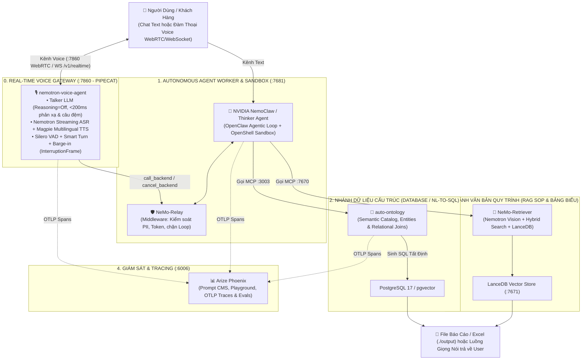
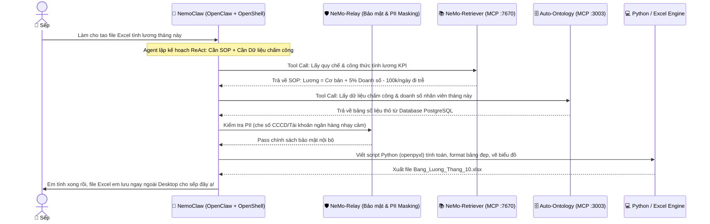

# 01. NVIDIA NeMo Framework (`01-nvidia-framework`)

> **Triết lý:** Chuẩn Enterprise chính hãng của NVIDIA. Tích hợp các trụ cột mã nguồn mở chính thức của NVIDIA để tạo nên một hệ thống **Multimodal Agentic Analytics & Semantic Graph Platform** hoàn chỉnh: Giao diện giọng nói thời gian thực (`nemotron-voice-agent` với kiến trúc phân thân `Talker LLM / Thinker LLM` trên `Pipecat`), Điều phối nhóm tác tử (`NeMo-Agent-Toolkit`), Runtime middleware (`NeMo-Relay`), Tầng ngữ nghĩa Text-to-SQL (`auto-ontology`), Trích xuất văn bản SOP (`NeMo-Retriever`), Tác tử tự hành (`NemoClaw` / `OpenShell`) và Cổng kiểm định kỹ năng Agent (`SkillEvaluator`).

---

## 🏛️ Sơ Đồ Kiến Trúc Luồng (Architecture Flow)

---

## ⚖️ Đánh Giá Ưu & Nhược Điểm Của Hệ Thống

### ✅ Ưu điểm:
- **Zero-Code (Không code dù chỉ 1 dòng):** Toàn bộ hệ sinh thái kết nối "Cắm và Chạy" qua chuẩn giao thức MCP.
- **OCR chạy Local độc lập:** Bộ model thị giác Nemotron (`nemotron-page-elements-v3`, `nemotron-table-structure-v1` dùng kiến trúc YOLOX ~54M nhẹ nhàng) chạy local trên GPU phổ thông, yên tâm cấp năng lực cho Agent xử lý tác vụ văn phòng: giúp Kế toán đọc hóa đơn/nhập liệu, giúp Nhân sự lọc thô hàng trăm CV.
- **Bảo mật doanh nghiệp với Sandbox:** Lồng sắt NVIDIA OpenShell cô lập hoàn toàn môi trường thực thi, triệt tiêu nguy cơ RCE và Indirect Prompt Injection.
- **Hệ sinh thái Observability sẵn có:** Arize Phoenix tích hợp sẵn Prompt CMS, Playground thử nghiệm prompt và Accounting/Tracing ở mức cơ bản.

### ⚠️ Nhược điểm:
- **OCR thuần hãng chưa hỗ trợ Tiếng Việt:** Model gốc `nemotron-ocr-v2` thiếu 67 ký tự có dấu (cần dùng giải pháp lai PaddleOCR local hoặc fine-tune Recognizer sau).
- **Accounting chỉ dừng ở mức đếm token:** Phoenix chỉ đếm token và trace OTLP cơ bản, chưa có hệ thống phân bổ chi phí/billing sâu theo từng User/Phòng ban như ClickHouse (Langfuse).

---

## 🎯 Quy Trình Tác Vụ Thực Tế (Autonomous Agentic Flow)

Ví dụ thực tế khi Sếp giao task: *"Làm cho tao file Excel tính lương tháng này"*:

---

## 📦 Danh Mục Dịch Vụ Docker Compose

Chi tiết cấu hình và các chế độ chạy xem tại **[DEPLOYMENT.md](./DEPLOYMENT.md)** và **[docker-compose.yaml](./docker-compose.yaml)**.

| Service Container | Cổng | Vai Trò Trong Hệ Thống |
| :--- | :--- | :--- |
| **`auto-ontology-frontend`** | `:3000` | Giao diện đồ thị tri thức Next.js & quản trị Ontology. |
| **`auto-ontology`** | `:3001` | FastAPI Backend sinh câu lệnh SQL tất định (NL-to-SQL). |
| **`ingestion-service`** | `:3002` | Worker quét schema và dữ liệu mẫu từ Database nguồn vào `pgvector`. |
| **`auto-ontology-mcp`** | `:3003` | MCP Server chính chủ cho luồng truy vấn dữ liệu có cấu trúc (`/mcp`). |
| **`postgres`** | `:5432` | `pgvector/pgvector:pg17` lưu trữ catalog, schema và vector ngữ nghĩa. |
| **`retriever`** | `:7670` | NeMo-Retriever Service & MCP Server xử lý tài liệu đa phương thức, bảng biểu & SOP. |
| **`vectordb`** | `:7671` | LanceDB Vector Store lưu trữ và truy xuất embedding. |
| **`phoenix`** | `:6006` / `:4317` | Arize Phoenix UI (Prompt CMS, Playground, Evals) và OTLP Collector thu thập trace. |
| **`nemoclaw`** | `:7681` | Autonomous Always-on Agent Worker (OpenShell Sandbox & OpenClaw Loop). |
| **`nemotron-voice-agent`** | `:7860` | Cổng đàm thoại thời gian thực (Pipecat WebRTC/WebSocket + `/v1/realtime`, kiến trúc phân thân `Talker LLM / Thinker LLM`, Silero VAD & Barge-in). |
| **`nim-page-elements` / `nim-table-structure` / `nim-ocr`** | `:8001`–`:8003` | *(Profile `local-vision`)* Bộ 3 container NIM tự host `nemotron-page-elements-v3`, `nemotron-table-structure-v1` & `nemotron-ocr-v2` tại chỗ. |
| **`nim-asr-streaming` / `nim-tts-magpie`** | `:9001` (`:50152`) / `:9000` (`:50151`) | *(Profile `local-voice`)* Bộ 2 container NIM tự host `nemotron-asr-streaming` & `magpie-tts-multilingual` qua gRPC/HTTP. |

---

## 📎 Phụ Lục: Các Liên Kết & Giải Phẫu Linh Kiện

Bảng tra cứu nhanh các module nguồn mở chính thức từ NVIDIA được tích hợp trong stack:

| Linh Kiện | Kho Mã Nguồn | Giải Thích Ngắn Gọn |
| :--- | :--- | :--- |
| **Nemotron Voice Agent** | [NVIDIA-AI-Blueprints/nemotron-voice-agent](https://github.com/NVIDIA-AI-Blueprints/nemotron-voice-agent) | Cổng giao tiếp giọng nói thời gian thực (<200ms phản xạ) xây dựng trên `Pipecat`, tích hợp sẵn VAD Barge-in (`InterruptionFrame`), kiến trúc Cascaded `Talker LLM / Thinker LLM`, Nemotron Streaming ASR & Magpie Multilingual TTS. |
| **NeMo-Agent-Toolkit** | [NVIDIA/NeMo-Agent-Toolkit](https://github.com/NVIDIA/NeMo-Agent-Toolkit) | Bộ khung điều phối đa tác tử (Orchestration), phân vai cho nhóm Agent (Scout, SQL Specialist, SOP Reader). |
| **NeMo-Relay** | [NVIDIA/NeMo-Relay](https://github.com/NVIDIA/NeMo-Relay) | Lớp Interceptor/Middleware chặn vòng đời Agent (`on_tool_start`, `on_llm_call`), kiểm soát timeout, PII và đếm token. Cung cấp plugin chính thức `nemo-relay-openclaw`. |
| **Auto-Ontology** | [NVIDIA/auto-ontology](https://github.com/NVIDIA/auto-ontology) | Tầng đồ thị ngữ nghĩa (Semantic Graph) sinh câu lệnh SQL tất định 100% cho dữ liệu có cấu trúc, tích hợp sẵn MCP Server. |
| **NeMo-Retriever** | [NVIDIA/NeMo-Retriever](https://github.com/NVIDIA/NeMo-Retriever) | Động cơ trích xuất văn bản dài, bóc tách bảng biểu bằng hệ model Nemotron Vision, Hybrid Search (Dense + BM25) kèm Reranker cho tài liệu quy trình SOP. |
| **NemoClaw & OpenShell** | [NVIDIA/NemoClaw](https://github.com/NVIDIA/NemoClaw) & [OpenShell](https://github.com/NVIDIA/OpenShell) | Runtime tác tử tự hành 24/7 (OpenClaw) chạy bên trong lồng sắt an toàn cấp nhân Linux (OpenShell Sandbox). |
| **SkillEvaluator** | [NVIDIA/SkillEvaluator](https://github.com/NVIDIA/SkillEvaluator) | Cổng kiểm định chất lượng (Linter & Evaluator) cho các file `SKILL.md` theo chuẩn Prompt-as-Code trước khi release. |
