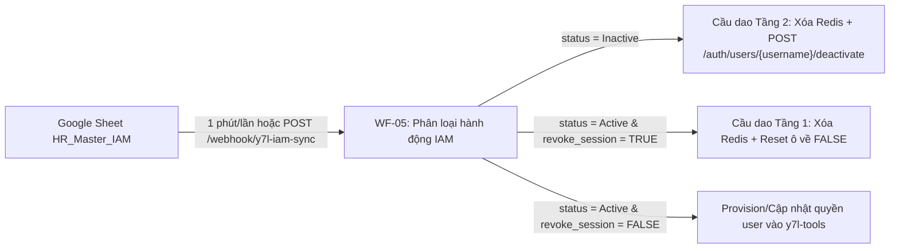

# Sổ Tay Hướng Dẫn Nghiệp Vụ & Xử Lý Tình Huống (`03-y7l-native`)

> **Phạm vi tài liệu:**  
> Tài liệu [`DEPLOYMENT.md`](./DEPLOYMENT.md) dành cho kỹ sư dựng và cấu hình hạ tầng. Tài liệu này dành cho **vận hành nghiệp vụ hằng ngày và xử lý sự cố thực chiến** theo từng phòng ban (**Kế toán FinOps**, **Kế toán trưởng / Nghiệp vụ**, **Nhân sự HR**, **Sale / Ban Giám đốc**, và **IT Ops**).

---

## 1. Ma Trận Phân Công & Công Cụ Theo Vai Trò

| Vai trò | Công cụ mở hằng ngày | Nghiệp vụ phụ trách | Workflow / Thành phần xử lý ngầm |
| :--- | :--- | :--- | :--- |
| **Kế toán FinOps / Ban Giám đốc** | Google Sheet `AI_Token_Ledger` (`$Y7L_FINOPS_SHEET_ID`) + **LiteLLM `:4000`** *(tuỳ chọn Ngày 10: Langfuse `:3100`)* | Theo dõi token & chi phí USD theo phòng ban/model; cấp, khóa nóng hoặc mở khóa Virtual Key ngân sách | `WF-06` ([`06_finops_token_ledger_sheet.json`](./n8n-workflows/06_finops_token_ledger_sheet.json)), [`src/y7l_tools/pricing.py`](./src/y7l_tools/pricing.py), Redis `y7l:finops:*` |
| **Kế toán trưởng / Nghiệp vụ** | **Obsidian** (mở [`vault/`](./vault/)) + API nạp SOP `WF-03` | Quản lý công thức tính doanh thu, cảnh báo bẫy dữ liệu `DATA_TRAP`, quy trình hoàn đơn/phụ cấp (SOP) | [`src/y7l_tools/vault.py`](./src/y7l_tools/vault.py), [`evals/vault_linter.py`](./evals/vault_linter.py), `WF-02`, `WF-03` |
| **Nhân sự (HR)** | Google Sheet `HR_Master_IAM` (`$Y7L_IAM_SHEET_ID`) | Thêm/cập nhật nhân viên, phân quyền vùng RLS (`region`) & bấm **Cầu dao 2 cấp** | `WF-05` ([`05_hr_master_iam_killswitch.json`](./n8n-workflows/05_hr_master_iam_killswitch.json)), [`src/y7l_tools/auth.py`](./src/y7l_tools/auth.py), Redis `y7l:session:*` |
| **Sale / Ban Giám đốc (End-user)** | **Zalo / Telegram / Webhook** + Webview Login HTML | Đăng nhập 10h JWT, hỏi KPI chuẩn, hỏi số liệu tự do nhận CSV/Excel, hỏi SOP, gửi/nhận Voice Memo | `WF-01`, `WF-02`, `WF-03`, `WF-04`, DuckDB RLS [`src/y7l_tools/sql_executor.py`](./src/y7l_tools/sql_executor.py) |
| **IT Ops / Kỹ sư vận hành** | **n8n `:5678`**, Docker Compose, Sidecar **`y7l-tools :8300`** | Giám sát sức khỏe dịch vụ, nối Credential (`Redis`, `Google Sheets`, `Postgres`), nạp DB `pgvector`, xử lý sự cố | [`DEPLOYMENT.md`](./DEPLOYMENT.md), [`db/init_sop_hybrid.sql`](./db/init_sop_hybrid.sql), [`src/y7l_tools/guard.py`](./src/y7l_tools/guard.py) |

---

## 2. Quy Trình 1 — Kế Toán FinOps & Ban Giám Đốc: Quản Lý Chi Phí Token AI & Cắt Cầu Dao Ngân Sách

### 2.1. Sổ cái theo dõi hằng ngày (`AI_Token_Ledger`)
Kế toán FinOps mở trực tiếp Google Sheet có ID `$Y7L_FINOPS_SHEET_ID` (đã khai báo trong `.env`):
1. **Tab `AI_Token_Ledger` (11 cột):** Mọi lượt gọi LLM từ `WF-01`, `WF-02` và `WF-03` đều tự động đẩy về webhook `WF-06` (`/webhook/y7l-token-log`) để quy đổi USD và ghi 1 dòng mới gồm:  
   `timestamp | month | department | user_id | workflow | model | prompt_tokens | completion_tokens | total_tokens | estimated_cost_usd | status`
2. **Tab `FinOps_Dashboard`:** Đã lắp sẵn công thức `COUNTIF`, `SUMIF` và `SUM` tự động cộng tổng lượt gọi, tổng token và tổng chi phí USD theo **từng Phòng ban** và **từng Model**.

> [!IMPORTANT]
> **Quy định bắt buộc về định dạng Google Sheet:**  
> Phải giữ Spreadsheet Locale ở chế độ **`en_US`** (dấu chấm `.` cho số thập phân, dấu phẩy `,` ngăn cách tham số công thức). Nếu đổi sang `vi_VN`, `n8n` ghi chuỗi `estimated_cost_usd` dạng `0.000522` bằng chế độ `USER_ENTERED` sẽ bị Google Sheet hiểu nhầm thành text hoặc sai thập phân, làm `SUMIF` trả về `0`.

### 2.2. Bảng đơn giá tham chiếu đang áp dụng
Đơn giá tính trên **1.000.000 tokens** (đồng bộ giữa [`src/y7l_tools/pricing.py`](./src/y7l_tools/pricing.py) và node `Normalize_And_Compute_Cost` trong `WF-06`):

| Tên Model | Giá Input / 1M tokens | Giá Output / 1M tokens | Ghi chú sử dụng |
| :--- | :---: | :---: | :--- |
| `yggdrasil-default-llm` / `deepseek-chat` | `$0.27` | `$1.10` | Model mặc định định tuyến & sinh SQL/SOP |
| `gpt-4o-mini` / `gemini-2.5-flash` | `$0.15` | `$0.60` | Model chi phí thấp cho tác vụ nhanh |
| `gpt-4o` | `$2.50` | `$10.00` | Model cao cấp cho suy luận phức tạp |
| `nvidia/llama-3.1-nemotron-70b-instruct` | `$0.88` | `$0.88` | Model Nemotron qua API tương thích OpenAI |
| `text-embedding-3-small` | `$0.02` | `$0.00` | Nhúng vector tài liệu SOP (`WF-03`) |
| `whisper-1` | `$0.00` | `$0.00` | Bóc băng Voice STT (tính riêng nếu dùng upstream trả phí) |
| Model lạ khác *(fallback mặc định)* | `$0.30` | `$1.20` | Áp dụng khi model chưa có trong bảng giá |

### 2.3. Quy trình Cấp / Khóa nóng / Mở khóa / Xóa Virtual Key phòng ban
Hệ thống tách bạch rõ 2 lớp kiểm soát tiền:
- **Chốt chặn cứng theo USD:** Thực hiện bằng `max_budget` gắn trên Virtual Key của **LiteLLM Proxy (`:4000`)** ([`litellm_config.yaml`](./litellm_config.yaml)). Khi vượt trần ngân sách, LiteLLM tự từ chối request ngay tại cổng gateway (hoặc `WF-06` tự gọi `/key/block`).
- **Bộ đếm nhanh trong Redis (`y7l:finops:<department>:<YYYY-MM>`, TTL 31 ngày):** Đếm nhanh mức hoạt động theo tháng qua node Redis trong `WF-06`. Lưu ý rằng node Redis `incr` mặc định của n8n tăng bộ đếm theo lượt gọi `+1` chứ không cộng tiền USD; chốt chặn ngân sách cứng bằng tiền vẫn dựa vào `max_budget` của LiteLLM Virtual Key.

Khi FinOps cần thao tác Virtual Key, gửi `POST` tới webhook `WF-06` (`http://localhost:5678/webhook/y7l-key-control`):
1. **Cấp Virtual Key mới có trần ngân sách (ví dụ `$10.0` cho phòng `sales`):**
   ```json
   {
     "action": "generate",
     "payload": {
       "max_budget": 10.0,
       "metadata": { "department": "sales" }
     }
   }
   ```
2. **Khóa nóng ngay lập tức (Cắt cầu dao trong 1 giây khi phát hiện bất thường):**
   ```json
   {
     "action": "block",
     "key": "<virtual_key>"
   }
   ```
3. **Mở khóa lại sau khi Ban Giám đốc duyệt bổ sung ngân sách:**
   ```json
   {
     "action": "unblock",
     "key": "<virtual_key>"
   }
   ```
4. **Xóa vĩnh viễn Virtual Key hết hạn / dự án đã đóng:**
   ```json
   {
     "action": "delete",
     "key": "<virtual_key>"
   }
   ```

*(Ghi chú gọi trực tiếp LiteLLM nếu thao tác thủ công: dùng header `Authorization: Bearer <LITELLM_MASTER_KEY>`)*

### 2.4. Đối soát cuối tháng & nâng cấp Ngày 10
- **Cuối tháng (Ngày 1–2):** Kế toán FinOps xuất tab `FinOps_Dashboard` và `AI_Token_Ledger` ra `.xlsx` để đối chiếu hóa đơn của nhà cung cấp LLM (OpenAI / DeepSeek / Google) và phân bổ chi phí AI theo từng phòng ban.
- **Thuế nhà thầu (FCT) & chốt sổ bill AI:** Xem quy trình tra cứu NCCNN (`etaxvn.gdt.gov.vn`), khai `01/NTNN` (OpenAI / Anthropic) và tải hóa đơn Google AI Studio (qua Google Cloud Console) tại **[`QUY_TRINH_FCT_VA_CHOT_SO_AI.md`](../QUY_TRINH_FCT_VA_CHOT_SO_AI.md)**.
- **Nâng cấp Ngày 10:** Khi cần xem chi tiết từng câu hỏi/câu trả lời tốn bao nhiêu token hoặc chạy đánh giá tự động trên UI, chỉ cần khởi động cụm `../02-langfuse` (`:3100`) và điền `LANGFUSE_PUBLIC_KEY` / `LANGFUSE_SECRET_KEY` cho container LiteLLM — giữ nguyên 100% 6 workflow trong n8n, dữ liệu vẫn song song đổ về Google Sheet.

---

## 3. Quy Trình 2 — Kế Toán Trưởng & Nghiệp Vụ: Cập Nhật Luật Tính Tiền, `DATA_TRAP` & Tài Liệu SOP

### 3.1. Quản lý công thức & `DATA_TRAP` trong Obsidian Vault
Toàn bộ ngữ nghĩa dữ liệu của AI nằm tại thư mục [`vault/`](./vault/) (kế toán mở trực tiếp bằng Obsidian):
- [`vault/glossary/`](./vault/glossary/): Khái niệm và công thức tài chính chuẩn (ví dụ: [`Doanh_Thu_Thuan.md`](./vault/glossary/Doanh_Thu_Thuan.md)).
- [`vault/tables/`](./vault/tables/): Cấu trúc bảng, cột phân quyền RLS và cảnh báo bẫy dữ liệu `DATA_TRAP` (ví dụ: [`gold_sales_obt.md`](./vault/tables/gold_sales_obt.md), [`dim_customers.md`](./vault/tables/dim_customers.md), [`fmcg_sales_6m.md`](./vault/tables/fmcg_sales_6m.md)).
- [`vault/sop/`](./vault/sop/): Quy trình nghiệp vụ và chính sách nội bộ (ví dụ: [`quy_trinh_hoan_don.md`](./vault/sop/quy_trinh_hoan_don.md), [`chinh_sach_phu_cap_2026.md`](./vault/sop/chinh_sach_phu_cap_2026.md)).

**4 bước chuẩn khi kế toán sửa hoặc thêm luật nghiệp vụ mới:**
1. **Mở và chỉnh sửa bằng Obsidian:** Giữ nguyên cấu trúc YAML frontmatter đầu file (`entity`, `type`, `related` liên kết bằng `[[Wikilinks]]`).
2. **Khai báo rõ các `DATA_TRAP:`** ngay dưới phần mô tả bảng để AI và bộ kiểm tra SQL (`guard.py`) tự động chặn sai số:
   - `gold_sales_obt`: Cấm dùng `total_price` (`DATA_TRAP: total_price_zero`, phải tính `SUM(quantity * unit_price) - SUM(discount)`); bắt buộc lọc `WHERE is_deleted = false` (`DATA_TRAP: soft_delete`).
   - `dim_customers`: Bắt buộc loại khách hàng test bằng `customer_id NOT LIKE 'TEST_%'` (`DATA_TRAP: test_accounts`).
   - `fmcg_sales_6m` (6.758.125 dòng): Toàn bộ cột `total_price = 0.0` (`DATA_TRAP: total_price_zero`, tổng hợp theo `SUM(quantity)` và `AVG(discount)`); có `67.526` dòng `sales_date IS NULL` (`DATA_TRAP: null_sales_date`, bắt buộc `WHERE sales_date IS NOT NULL` khi thống kê theo thời gian).
3. **Chạy kiểm định Vault Linter sau khi bấm Save:**  
   Gọi `GET http://localhost:8300/vault/lint` (hoặc chạy `uv run python evals/vault_linter.py`) để chắc chắn kết quả đạt **`0` lỗi**, không có `[[Wikilink]]` gãy hoặc frontmatter sai định dạng.
4. **Hiệu lực tức thì (Zero-Chunking):** Khi có câu hỏi SQL (`WF-02`), hệ thống đọc nguyên file `.md` + nối 1 bước các note liên quan tại thời điểm hỏi — **không cần cắt chunk hay đợi IT deploy lại code**.

### 3.2. Quy trình hoàn đơn & trả hàng chuẩn (`SOP-FIN-001`)
Quy định hiện hành tại [`quy_trinh_hoan_don.md`](./vault/sop/quy_trinh_hoan_don.md):
- **Thời hạn tiếp nhận (SLA):** Trong vòng **7 ngày** kể từ ngày xuất hóa đơn. Các yêu cầu quá 7 ngày bắt buộc phải có xác nhận ngoại lệ từ Giám đốc Kinh doanh khu vực.
- **Thẩm quyền phê duyệt theo giá trị đơn:**
  - **Từ `5.000.000 VNĐ` trở xuống:** Trưởng nhóm Sale khu vực phê duyệt trên hệ thống và chuyển Kế toán viên đối soát.
  - **Trên `5.000.000 VNĐ`:** Bắt buộc có **phê duyệt của Kế toán trưởng (Chief Accountant)** kèm biên bản xác nhận nhập kho trước khi giải ngân hoàn tiền.
- **Hạch toán cuối ngày:** Mọi đơn hoàn đã phê duyệt được cập nhật cờ `is_deleted = true` trong bảng `gold_sales_obt` ở kỳ đối soát cuối ngày để không tính vào Doanh thu thuần.

### 3.3. Quy trình nạp / cập nhật tài liệu SOP mới cho RAG Hybrid (`WF-03`)
Khi ban hành quy định mới dạng `.md`, `.txt`, `.csv` hoặc `.pdf` (ví dụ chính sách phụ cấp Quý [`chinh_sach_phu_cap_2026.md`](./vault/sop/chinh_sach_phu_cap_2026.md)):
1. Chuẩn bị file tài liệu rõ ràng (với PDF dạng scan ảnh chưa có text lớp dưới thì dùng Vision LLM trích text trước).
2. Gửi `POST` dạng `multipart/form-data` (trường binary tên `data`) vào webhook `WF-03`:  
   `http://localhost:5678/webhook/y7l-rag-sop-ingest`
3. `WF-03` tự động gọi `y7l-tools /ocr/extract` để bóc chữ và chia đoạn (`max_chars=900`, `overlap=100`), gọi LiteLLM tạo vector `text-embedding-3-small`, ghi log chi phí về `WF-06`, rồi lưu đè/cập nhật (`ON CONFLICT (doc_id, chunk_index) DO UPDATE`) vào Postgres bảng `y7l_sop_chunks` cùng chỉ mục tìm kiếm kết hợp Dense + BM25.

---

## 4. Quy Trình 3 — Nhân Sự (HR): Cấp Quyền Người Dùng, Phân Vùng RLS & Cầu Dao 2 Cấp

Nhân sự chỉ làm việc trên Google Sheet **`HR_Master_IAM`** (`$Y7L_IAM_SHEET_ID`):

| Tên cột | Giá trị hợp lệ | Ý nghĩa nghiệp vụ |
| :--- | :--- | :--- |
| `username` | Chuỗi không dấu (vd: `sale_north`) | Tài khoản đăng nhập qua Webview Login (`WF-04`) |
| `chat_user_id` | ID Zalo / Telegram (vd: `zalo_n01`) | Khóa định danh người dùng trên kênh chat & Redis session |
| `department` | `sales`, `finance`, `hr`, `ops`, `board`, ... | Nhãn phòng ban dùng để hạch toán token & đối soát |
| `region` | `North`, `South`, `Central`, hoặc `*` | Phạm vi dữ liệu được phép xem (RLS); `*` chỉ cấp cho Kế toán trưởng / Ban Giám đốc |
| `role` | `sales`, `accountant`, `chief_accountant`, `hr`, `director` | Vai trò nghiệp vụ trong JWT |
| `status` | `Active` hoặc `Inactive` | Trạng thái nhân sự (`Inactive` kích hoạt Cầu dao Tầng 2) |
| `revoke_session` | `TRUE` hoặc `FALSE` | Tích `TRUE` kích hoạt Cầu dao Tầng 1 thu hồi phiên ngay |



**4 kịch bản xử lý chuẩn cho HR:**
1. **Nhân viên mới (Onboarding):** Thêm 1 dòng mới vào tab `HR_Master_IAM`, điền đầy đủ `username`, `chat_user_id`, `department`, `region`, `role`, đặt `status = Active`, `revoke_session = FALSE`. Hệ thống tự đồng bộ trong tối đa 1 phút (hoặc gọi ngay `POST http://localhost:5678/webhook/y7l-iam-sync`).
2. **Điều chuyển khu vực / thay đổi chức vụ:** Sửa cột `region` hoặc `role` về giá trị mới **VÀ đồng thời chuyển `revoke_session = TRUE`**. Việc tích `revoke_session` buộc hệ thống xóa JWT cũ mang quyền khu vực cũ trong Redis, ép nhân viên đăng nhập lại để nhận JWT quyền mới ở tin nhắn kế tiếp.
3. **Mất điện thoại / nghi ngờ lộ thiết bị — Cầu dao Tầng 1 (Soft Revoke):** Giữ `status = Active`, chuyển `revoke_session = TRUE`. Trong vòng 1 phút, `WF-05` xóa key `y7l:session:<chat_user_id>` khỏi Redis và tự động đặt lại ô `revoke_session` về `FALSE`. Nhân viên bị đăng xuất tức thì nhưng vẫn có thể đăng nhập lại sau khi đổi thiết bị/mật khẩu.
4. **Nhân viên nghỉ việc / chấm dứt quyền — Cầu dao Tầng 2 (Hard Kill-Switch):** Chuyển `status = Inactive`. Trong vòng 1 phút, `WF-05` vừa xóa phiên Redis vừa gọi `POST /auth/users/{username}/deactivate` trên `y7l-tools` để vô hiệu hóa vĩnh viễn tài khoản — không thể đăng nhập lại bằng bất kỳ cách nào.

---

## 5. Quy Trình 4 — Sale & Ban Giám Đốc (Người Dùng Cuối): Đăng Nhập, Hỏi Số Liệu & Voice Memo

### 5.1. Xác thực Zero-Trust 10 tiếng (`WF-04`)
1. Ở tin nhắn đầu tiên hoặc khi phiên 10 tiếng hết hạn, `WF-01` không thấy `y7l:session:<chat_user_id>` trong Redis và trả về `HTTP 401` kèm đường dẫn Webview Login (`GET /webhook/y7l-login?uid=<chat_user_id>`).
2. Người dùng bấm mở link Webview trên trình duyệt/Zalo, nhập `username` + `password` rồi gửi form (`POST /webhook/y7l-login-submit`).
3. Sidecar `y7l-tools` đối chiếu mật khẩu PBKDF2-HMAC-SHA256, cấp JWT có thời hạn **10 giờ (`36000s`)**, `WF-04` lưu JWT vào Redis dưới key `y7l:session:<chat_user_id>` và **hủy mật khẩu ngay lập tức** (tuyệt đối không nhắn mật khẩu trực tiếp vào khung chat).

### 5.2. Định tuyến 3 luồng xử lý qua `WF-01` (`/webhook/y7l-chat`)
Khi đã có JWT hợp lệ trong Redis, mọi câu hỏi text hoặc Voice Memo đều đi qua `WF-01` để điều phối về đúng 1 trong 3 luồng:

| Luồng | Khi nào chạy? | Cơ chế xử lý & Bảo mật | Đầu ra trả về |
| :--- | :--- | :--- | :--- |
| **Luồng 1: KPI Chuẩn (`Saved Metrics`)** | Câu hỏi khớp chỉ số chuẩn (`net_revenue_by_region`, `monthly_revenue`, `top_customers`, `order_count_summary`, `fmcg_6m_monthly_summary`, `fmcg_6m_salesperson_ranking`) | Chạy SQL cố định qua DuckDB RLS, cache Redis **60 giây** theo khóa `y7l:metric:<metric>:<region>:<role>:<format>` (trúng cache `< 10ms`) | Bảng Markdown xem nhanh + file đính kèm (`.csv`/`.xlsx`/`.md`) |
| **Luồng 2: Hỏi Số Liệu Tự Do (`WF-02` Single-Hop SQL)** | Câu hỏi phân tích số liệu bất kỳ không nằm trong danh mục KPI cố định | 1. Che PII Việt Nam (CCCD 12 số, SĐT, email, STK)<br>2. Đọc Obsidian Zero-Chunking + `[[Wikilinks]]`<br>3. LLM sinh **1 câu SQL `SELECT` read-only** (chặn DDL/DML/`read_parquet`)<br>4. DuckDB tự kẹp điều kiện `region` theo JWT (Sale Bắc chỉ thấy Bắc) | Trả thẳng bảng Markdown + link `/artifacts/<filename>` — **dữ liệu doanh số không vòng ngược qua LLM** |
| **Luồng 3: Hỏi Quy Trình / Chính Sách (`WF-03` Hybrid RAG)** | Câu hỏi về quy trình hoàn đơn, phụ cấp, quy định nội bộ | Tạo embedding qua LiteLLM -> chạy `y7l_hybrid_search_sop` trên Postgres (Dense + BM25 + RRF Top-3 `< 4KB`) -> tổng hợp câu trả lời | Câu trả lời kèm mã trích dẫn tài liệu (vd: `SOP-FIN-001`, `SOP-HR-2026-Q4`) |

### 5.3. Quy trình Voice Memo Tối Thiểu (Vào & Ra)
- **Đầu vào thoại:** Khi payload gửi kèm âm thanh (`is_voice=true`, `audio_url` hoặc `audio_base64`) mà chưa có text `prompt`, `WF-01` tự gọi `y7l-tools /voice/stt` (qua Whisper proxy `/audio/transcriptions` với `language=vi`) để chuyển giọng nói thành văn bản trước khi kiểm tra JWT và phân luồng.
- **Đầu ra thoại:** Nếu yêu cầu gốc là Voice Memo (`is_voice=true`), sau khi tổng hợp câu trả lời văn bản từ Luồng 1/2/3, `WF-01` gọi tiếp `y7l-tools /voice/tts` (Edge-TTS tiếng Việt) để xuất file âm thanh `.mp3` kèm link tải về (`/artifacts/y7l_voice_*.mp3`) cùng tóm tắt văn bản.

---

## 6. Quy Trình 5 — Sổ Tay Xử Lý Sự Cố Thực Chiến (Troubleshooting Runbook)

| # | Tình huống / Triệu chứng | Nguyên nhân thường gặp | Cách xử lý từng bước | Phụ trách |
| :---: | :--- | :--- | :--- | :--- |
| **1** | Bot trả `HTTP 401` / yêu cầu đăng nhập lại dù mới dùng | Phiên 10 tiếng đã hết hạn trên Redis, HR vừa bấm `revoke_session`, hoặc container Redis vừa restart mất RAM | Bấm lại link Webview Login (`/webhook/y7l-login?uid=<uid>`) để lấy JWT mới; kiểm tra trạng thái `Active` trên `HR_Master_IAM`; kiểm tra kết nối `n8n` -> `redis:6379` | End-user / HR / IT Ops |
| **2** | Sale hỏi số liệu nhận *"Bạn không có quyền truy cập hoặc dữ liệu không tồn tại"* | Cột `region` của nhân viên không khớp vùng dữ liệu đang hỏi (RLS đang chặn đúng), hoặc câu SQL lọc nhầm điều kiện | Kiểm tra cột `region` của user trên `HR_Master_IAM`; nếu vừa đổi vùng nhớ tích `revoke_session = TRUE` để hủy JWT cũ | HR / Kế toán |
| **3** | Truy vấn SQL bị chặn hoặc trả về cảnh báo `DATA_TRAP` | Câu SQL có từ khóa bị cấm (`DROP`, `DELETE`, `UPDATE`, `read_parquet`, `;`) hoặc LLM dùng nhầm cột lỗi `total_price`, quên `is_deleted = false` / `sales_date IS NOT NULL` / `TEST_%` | Mở lại file bảng tương ứng trong [`vault/tables/`](./vault/tables/), kiểm tra khối `DATA_TRAP` xem mô tả đã rõ chưa; chạy `GET http://localhost:8300/vault/lint` | Kế toán / IT Ops |
| **4** | Gọi AI báo `HTTP 403`/`429` (hết hạn mức) hoặc `HTTP 500` từ LiteLLM (`:4000`) | `403`/`429`: Virtual Key phòng ban đã chạm `max_budget` hoặc bị block.<br>`500`: Lỗi kết nối / API key nhà cung cấp upstream (DeepSeek/OpenAI) trên LiteLLM | Nếu hết budget: kiểm tra `FinOps_Dashboard`, duyệt tăng hạn mức và gọi `WF-06` `action: unblock`. Nếu `500`: kiểm tra biến môi trường API key & log container `litellm` | FinOps / IT Ops |
| **5** | HR đã đổi `status = Inactive` hoặc `revoke_session = TRUE` nhưng user chưa bị đá phiên | Chờ chưa đủ chu kỳ cron 1 phút, `WF-05` chưa được `Active` trong n8n, hoặc thiếu Credential **Google Sheets OAuth2** | Vào `n8n :5678` kiểm tra `WF-05` đang `Active` và node Google Sheets đã gắn OAuth2; cần đá phiên tức thì thì gọi `POST http://localhost:5678/webhook/y7l-iam-sync` | HR / IT Ops |
| **6** | Bảng `FinOps_Dashboard` bị `#ERROR!` hoặc `SUMIF` trả về `0` | Spreadsheet đang để Locale `vi_VN` (dùng dấu `;` thay `,` hoặc hiểu sai dấu chấm `.` thập phân ở cột `estimated_cost_usd`) | Vào **File -> Settings** trên Google Sheet, đặt Locale về **United States (`en_US`)**, Timezone **`Asia/Ho_Chi_Minh`** | Kế toán FinOps |
| **7** | Voice Memo không ra tiếng hoặc lỗi STT | `edge-tts` không gọi được WebSocket Microsoft ngoài mạng, hoặc model `whisper-1` chưa có `OPENAI_API_KEY` hợp lệ trên LiteLLM | Kiểm tra phản hồi văn bản đi kèm (vẫn trả bình thường); kiểm tra `OPENAI_API_KEY` trong LiteLLM (`:4000`) và kết nối outbound Internet nếu cần dùng giọng nói | IT Ops |
| **8** | Nghi ngờ sidecar `y7l-tools`, Redis hoặc workflow n8n bị treo | Container `y7l-tools` chưa khởi động, mất mạng Docker `data_platform_default`, hoặc workflow đang `inactive` | Chạy bộ lệnh kiểm tra nhanh 30 giây ở mục dưới đây | IT Ops |

### Kiểm tra sức khỏe toàn cụm nhanh trong 30 giây
```powershell
# 1. Kiểm tra Sidecar y7l-tools (:8300) và Obsidian Vault Linter
curl.exe -s http://localhost:8300/health
curl.exe -s http://localhost:8300/vault/lint

# 2. Kiểm tra n8n gọi được Redis nội bộ (trả về +PONG)
docker exec n8n node -e "const net=require('net'); const s=net.createConnection(6379,'redis',()=>{s.write('PING\r\n');}); s.on('data',d=>{console.log(d.toString().trim()); s.end();});"

# 3. Chạy kiểm định unit tests & Vault Linter tại repo
cd deploy/ai-platform/03-y7l-native
uv run python evals/vault_linter.py
uv run pytest -v
```

---

## 7. Phụ Lục — Danh Mục 6 Workflow `n8n` & Webhook Tra Cứu Nhanh

| Mã | Tên Workflow | Tệp JSON | Webhook / Trigger | Credential n8n cần gắn |
| :---: | :--- | :--- | :--- | :--- |
| **WF-01** | Chat & Minimal Voice Memo Entrypoint | [`01_chat_voice_entrypoint.json`](./n8n-workflows/01_chat_voice_entrypoint.json) | `POST /webhook/y7l-chat` | **Redis** (`redis:6379`) |
| **WF-02** | RAG Obsidian Zero-Chunking & Single-Hop SQL | [`02_rag_obsidian_sql_singlehop.json`](./n8n-workflows/02_rag_obsidian_sql_singlehop.json) | `POST /webhook/y7l-rag-sql` | Không cần *(gọi HTTP `y7l-tools` & LiteLLM)* |
| **WF-03** | RAG SOP Hybrid Search in n8n (Ingest + Query) | [`03_rag_sop_hybrid_n8n.json`](./n8n-workflows/03_rag_sop_hybrid_n8n.json) | `POST /webhook/y7l-rag-sop-ingest`<br>`POST /webhook/y7l-rag-sop-query` | **Postgres (`pgvector`)** (đã chạy [`init_sop_hybrid.sql`](./db/init_sop_hybrid.sql)) |
| **WF-04** | Webview OAuth Login (10h JWT) | [`04_webview_oauth_login.json`](./n8n-workflows/04_webview_oauth_login.json) | `GET /webhook/y7l-login`<br>`POST /webhook/y7l-login-submit` | **Redis** (`redis:6379`) |
| **WF-05** | HR Master IAM Google Sheet & 2-Tier Kill-Switch | [`05_hr_master_iam_killswitch.json`](./n8n-workflows/05_hr_master_iam_killswitch.json) | Cron `1 phút/lần`<br>`POST /webhook/y7l-iam-sync` | **Google Sheets OAuth2** + **Redis** (`redis:6379`) |
| **WF-06** | FinOps Token Ledger to Google Sheet & Key Kill-Switch | [`06_finops_token_ledger_sheet.json`](./n8n-workflows/06_finops_token_ledger_sheet.json) | `POST /webhook/y7l-token-log`<br>`POST /webhook/y7l-key-control` | **Google Sheets OAuth2** + **Redis** (`redis:6379`) |
