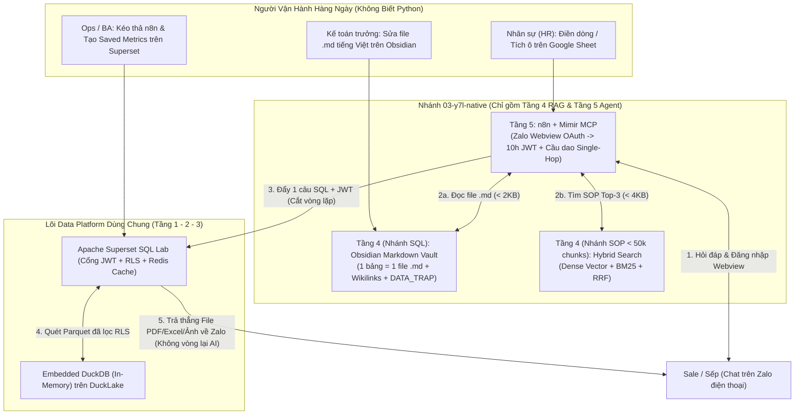

# 03. Y7L Native (`v0.1`) — Gói Khởi Động Tối Thiểu & Dặm Cuối (`03-y7l-native`)

  
   
  <em>🚧 <strong>Y7L Native Bootstrapping Engine — Đang Hoàn Thiện Các Chặng Kỹ Thuật (Under Construction)</strong> 🚧</em>

> **Định vị thực tế:**  
> Nhánh này **không phải** là một nền tảng AI hoàn chỉnh để đi so găng tính năng với `01-nvidia-framework` hay `02-langfuse`.  
> Nó chỉ là **gói chắp vá có kỷ luật ở giai đoạn `v0.1` (Bootstrapping — từ lúc doanh nghiệp chưa có gì đến lúc có cái chạy được ở Ngày 1)**, giải quyết 2 bài toán thực dụng: **ép tài nguyên về mức tối thiểu** và **xử lý "Dặm cuối" (Last-Mile)** khi những người vận hành chính hàng ngày (Kế toán, HR, Ops, Sale) **không biết viết code Python**. Khi doanh nghiệp lớn lên ở Ngày 10, từng phần của nhánh này sẽ bị cắt bỏ và thay thế dần.

---

## 1. Phạm Vi Của Nhánh Này: Chỉ Gồm Tầng 4 (RAG) & Tầng 5 (Agent)

Phần lõi **Data Platform (Tầng 1–2–3: Redpanda, MinIO, Bifrost Proxy, Valkyrie, DuckLake, Apache Superset RLS)** là hạ tầng dùng chung ở dưới. Nhánh `03-y7l-native` chỉ dựng thêm 2 lớp rất mỏng ở trên bằng cách tận dụng tối đa các công cụ có sẵn:

---

## 2. Nó Giải Quyết Vấn Đề Gì Ở Ngày 1? (Bootstrapping & Last-Mile)

Khi công ty mới bắt đầu làm dữ liệu, chưa có tiền thuê GPU (`01-nvidia`), chưa có nhu cầu dựng ClickHouse 6GB RAM để hạch toán triệu lệnh gọi AI (`02-langfuse`), và không có đội kỹ sư AI/Python trực chiến, `03-y7l-native` dùng các công cụ quen thuộc để chạy ngay:

### 2.1. Tầng 4 (RAG / Ngữ Nghĩa): Chia Đôi Để Đỡ Tốn Tiền & Dễ Sửa Bằng Tay
1. **Với cấu trúc bảng SQL (`Text-to-SQL`) $\to$ Dùng file Markdown trên Obsidian:**
   * **Không băm nhỏ (Zero-Chunking):** Mỗi bảng Gold OBT là 1 file `.md` ngắn (`300–800 tokens`), nối các bảng liên quan bằng `[[Wikilinks]]`.
   * **Kế toán tự sửa được (`DATA_TRAP`):** Khi hệ thống cũ có cột lỗi (ví dụ cột `total_price` bị lỗi bằng `0`, phải tính bằng `SUM(quantity * unit_price)`, hoặc phải lọc `WHERE is_deleted = false`), Kế toán trưởng mở file `.md` gõ cảnh báo bằng tiếng Việt rồi bấm Save. AI đọc trực tiếp file văn bản đó, không cần kỹ sư chạy lại pipeline Embedding.
2. **Với tài liệu quy trình nội bộ (`SOP < 50,000 chunks`) $\to$ Dùng Hybrid Search (`Dense + BM25 + RRF`):**
   * Bỏ qua kiến trúc cây phân cấp phức tạp (`Hyper-Scale Library` tốn `$140–$160 / 1B tokens` và đòi hỏi kỹ sư hiểu sâu về mật độ vector để cân bằng cây).
   * Dùng kết hợp **Dense Vector** + **BM25** (bắt mã quy trình, số hiệu tài khoản) + trộn hạng **RRF**: chi phí chỉ khoảng **`~$20 / 1B tokens`** (hoặc `~$0` nếu chạy model local), đạt **`~87 điểm ndcg_at_10`** trên bộ test MTEB Finance — đủ dùng cho quy mô dưới 50,000 đoạn văn bản.

### 2.2. Tầng 5 (Agent & Dặm Cuối): Chạy Trên `n8n` + `Zalo` + `Google Sheet`
1. **Giao diện Dặm cuối cho Sale ngoài đường (`Zalo + In-App Webview`):**
   * Sale đi thị trường chỉ cầm điện thoại, mở Zalo hỏi số liệu thay vì phải mở Dashboard BI.
   * Vì Zalo không cho Bot xóa tin nhắn chứa mật khẩu trong khung chat, `n8n` mở **Zalo Webview (In-App Browser)** để nhân viên đăng nhập tài khoản Superset, đổi lấy **JWT thời hạn 10 tiếng**, lưu ánh xạ `Zalo_User_ID <-> JWT` rồi xóa bỏ mật khẩu ngay lập tức.
2. **Quản lý quyền và cắt truy cập trên `Google Sheet` (Cho HR không biết IT):**
   * HR thêm nhân viên mới vào Google Sheet $\to$ `n8n` định kỳ quét và gọi API tạo tài khoản trên Superset.
   * **Cầu dao 2 cấp trên Sheet:** Nhân viên mất điện thoại $\to$ HR tích ô `Revoke Session` để xóa phiên JWT trên Zalo (Cấp 1). Nhân viên nghỉ việc $\to$ HR đổi trạng thái sang `Inactive` để xóa phiên Zalo đồng thời khóa tài khoản Superset (Cấp 2).
3. **3 Luồng xử lý & Cầu dao 1 nhịp (`Single-Hop Circuit Breaker`):**
   * **Luồng 1 (KPI có sẵn):** Gọi thẳng **Saved Metrics** của Superset (qua Redis Cache, `< 50ms`), không sinh SQL.
   * **Luồng 2 (Hỏi số liệu tự do — Cắt vòng lặp):** Model đọc file `.md` từ Obsidian $\to$ viết **đúng 1 câu SQL** rồi dừng. `n8n` đẩy `SQL + JWT` sang **Superset SQL Lab** (nơi Superset tự gắn điều kiện phân quyền dòng RLS `WHERE region = ...` và chạy trên DuckDB). Kết quả (`PDF / Excel / CSV / Ảnh biểu đồ`) được **gửi thẳng về Zalo cho người dùng, không trả ngược lại cho Model** để tránh lộ dữ liệu thô, tránh tràn bộ nhớ V8 Heap của `n8n` (`< 2GB RAM`), và ngăn Model tự ý lặp vòng sửa câu SQL.
   * **Luồng 3 (Hỏi quy trình SOP):** Gọi MCP lấy Top-3 đoạn văn bản (`< 4KB`), cho phép lặp (`LLM Loop`) bình thường để tổng hợp câu trả lời.

---

## 3. Những Hạn Chế Thật Sự Của Nhánh Này (Và Khi Nào Phải Thay Thế Ở Ngày 10)

Vì được thiết kế để tiết kiệm tối đa ở Ngày 1 (`v0.1`), nhánh này mang những **nhược điểm rất rõ ràng** khi quy mô doanh nghiệp phình to:

1. **Hoàn toàn mù về Kế toán chi phí AI (Zero FinOps / Accounting):**
   * Không có cổng AI Gateway thu phí, không biết phòng ban nào hay con Agent nào đang đốt bao nhiêu tiền token, không có giao diện quản lý phiên bản Prompt tập trung.
   * 👉 *Hướng thay thế ở Ngày 10:* Khi chạy nhiều Agent và cần kiểm soát chi phí cho phòng kế toán, phải cắm **[`02-langfuse`](../02-langfuse/README.md) (AI Gateway + ClickHouse)** vào chắn trước các lệnh gọi LLM.
2. **Phụ thuộc vào việc bảo trì thủ công trên Obsidian & Google Sheet:**
   * Với 20–50 bảng dữ liệu thì Kế toán trưởng sửa file `.md` trên Obsidian rất nhanh. Nhưng nếu hệ thống lên tới hàng trăm bảng hoặc có hàng vạn file PDF báo cáo tài chính bẩn cần bóc tách tự động, việc gõ tay từng file `.md` sẽ quá tải.
   * Tương tự, dùng Google Sheet làm bảng phân quyền IAM chỉ hợp với quy mô nhỏ; nếu ai đó lỡ tay xóa nhầm cột trên Sheet hoặc khi nhân sự lên hàng ngàn người thì phải bỏ để chuyển sang SSO/IAM chuẩn.
   * 👉 *Hướng thay thế ở Ngày 10:* Với bài toán bóc tách tài liệu lớn tự động, chuyển sang dùng **[`01-nvidia-framework`](../01-nvidia-framework/README.md)** (nếu có ngân sách GPU) hoặc nâng cấp pipeline tự động.
3. **Đánh đổi khả năng suy luận đa bước trên dữ liệu (Do cắt vòng lặp `Single-Hop`):**
   * Việc ép Model chỉ được viết 1 câu SQL rồi trả thẳng file cho người dùng giúp hệ thống cực kỳ an toàn và không tốn RAM, nhưng đồng thời **vô hiệu hóa khả năng phân tích sâu nhiều bước** (Model không được nhìn kết quả bước 1 để tự truy vấn tiếp bước 2 tìm nguyên nhân).
4. **Giới hạn của cặp điều phối `n8n + Airflow` và `DuckDB In-Memory`:**
   * Khi lỗi xảy ra phải mở cả `n8n` lẫn `Airflow` để dò log; khi dữ liệu vượt ngưỡng `100GB – 500GB` hoặc truy vấn Ad-hoc dồn dập làm mất tác dụng của Redis Cache thì DuckDB In-Memory sẽ nghẽn.
   * 👉 *Hướng thay thế ở Ngày 10:* Gộp điều phối về **Windmill.dev (Rust)** ([`ADR 0001`](../../../docs/adrs/0001-tech-stack-selection.md)) và nâng tầng OLAP lên **ClickHouse** ([`01_OLAP_Scaling_Strategy.md`](../../../docs/guides/01_OLAP_Scaling_Strategy.md)).

---

## 4. Bảng Chấm Điểm Thực Tế (Thang 0 – 10) So Với 2 Nhánh Kia

Đặt trên cùng một mặt phẳng đánh giá khách quan (không thiên vị), mỗi nhánh có vùng mạnh và vùng liệt rất rõ:

| Tiêu Chí Đánh Giá | `01-nvidia-framework` (Enterprise GPU) | `02-langfuse` (FinOps & Accounting) | `03-y7l-native` (`v0.1` Bootstrap) | Nhận Xét Thẳng Thắn |
| :--- | :---: | :---: | :---: | :--- |
| **1. Chi phí khởi động & Nhẹ tài nguyên (Bootstrapping Ngày 1)** | **2.0 / 10** | **5.5 / 10** | **9.5 / 10** | `03` tận dụng luôn Superset, Obsidian, n8n, Google Sheet nên chạy tốn thêm rất ít RAM. `02` cần thêm cụm ClickHouse (~4–6GB RAM). `01` đòi hỏi GPU. |
| **2. Giải quyết "Dặm cuối" & Vận hành không cần biết Python** | **2.0 / 10** | **6.0 / 10** | **9.0 / 10** | `03` cho phép Kế toán sửa file `.md` tiếng Việt, HR tích ô Google Sheet, Sale dùng Zalo. `02` có Web UI tốt cho Kế toán/PM nhưng vẫn cần Dev gắn SDK. `01` thuần kỹ thuật. |
| **3. Kiểm soát chi phí AI cho Phòng Kế toán (FinOps & Gateway)** | **3.5 / 10** | **9.5 / 10** | **1.0 / 10** | `03` hầu như **không có chức năng kế toán token** hay quản lý key theo phòng ban. Muốn quản lý tiền bạc bắt buộc phải dùng `02-langfuse` (kèm LiteLLM). |
| **4. Quản trị phiên bản Prompt, Tracing & Chấm điểm (Evals)** | **8.0 / 10** *(Phoenix + SkillEvaluator)* | **8.5 / 10** *(Prompt CMS + Datasets)* | **2.0 / 10** *(Debug tay trên n8n)* | `03` chỉ lưu prompt/schema trong file `.md` và log trên `n8n`, không có hệ thống Tracing chuẩn OpenTelemetry hay chấm điểm tự động như `01` và `02`. |
| **5. Tự động bóc tách tài liệu phức tạp & Xây dựng Knowledge Graph** | **9.5 / 10** *(Auto-Ontology + NeMo)* | **2.0 / 10** *(Không có)* | **5.0 / 10** *(Gõ tay Obsidian + Hybrid)* | `03` buộc con người phải tự viết file `.md` định nghĩa bảng và bẫy dữ liệu. Nếu lười viết hoặc có hàng vạn file PDF scan bẩn thì `01-nvidia` vượt trội hoàn toàn. |
| **6. Kỷ luật Bảo mật Dữ liệu Số (`Data-Blind` & Chống chế SQL)** | **7.0 / 10** | **5.0 / 10** | **9.0 / 10** | Nhờ bắt buộc đi qua **Superset RLS**, khóa công thức bằng **Obsidian `DATA_TRAP`** và **cắt vòng lặp (không trả dữ liệu thô về Model)**, `03` kiểm soát rủi ro lộ số liệu rất chặt. |

---

## 5. Tài Liệu Chi Tiết Trong Repo

* **Lộ trình Bootstrapping & Thời gian hoàn thành (Ngày 1 ➔ Ngày 10):** [`ROADMAP.md`](./ROADMAP.md)
* **Tóm tắt nhanh không lý thuyết:** [`mimir/docs/00_quickstart_without_theory.md`](https://github.com/next0258456/mimir/blob/main/docs/00_quickstart_without_theory.md)
* **Thiết kế Tầng 4 (Obsidian `DATA_TRAP` & Hybrid Search SOP):** [`docs/architecture/04_Knowledge_Semantic_Layer_Design.md`](../../../docs/architecture/04_Knowledge_Semantic_Layer_Design.md) & [`mimir/docs/02_data_blind_semantic_layer.md`](https://github.com/next0258456/mimir/blob/main/docs/02_data_blind_semantic_layer.md)
* **Thiết kế Tầng 5 (Zalo Webview, Google Sheet Kill-Switch & Single-Hop):** [`docs/architecture/05_AI_Gateway_Layer_Design.md`](../../../docs/architecture/05_AI_Gateway_Layer_Design.md) & [`mimir/docs/03_cognitive_gateway_and_dual_track.md`](https://github.com/next0258456/mimir/blob/main/docs/03_cognitive_gateway_and_dual_track.md)
* **Post-Mortem cắt bỏ `Hyper-Scale Library` & Benchmark 7 Task MTEB Finance:** [`mimir/docs/05_deescalation_and_fin_benchmarks.md`](https://github.com/next0258456/mimir/blob/main/docs/05_deescalation_and_fin_benchmarks.md)
* **Lộ trình thay thế nâng cấp ở Ngày 10 (`ADR 0001` & `OLAP Scaling`):** [`docs/adrs/0001-tech-stack-selection.md`](../../../docs/adrs/0001-tech-stack-selection.md) & [`docs/guides/01_OLAP_Scaling_Strategy.md`](../../../docs/guides/01_OLAP_Scaling_Strategy.md)
