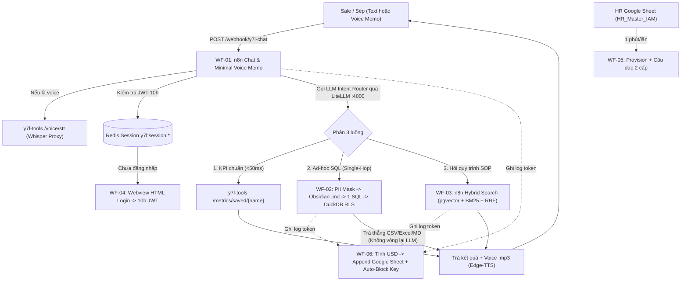

# 03. Y7L Native (`v0.1`) — Gói Khởi Động Thực Dụng Lấy `n8n` Làm Trung Tâm (`03-y7l-native`)

> **Định vị thực tế:**  
> Nhánh này triển khai đầy đủ bộ tính năng lõi đã hứa ở `01-nvidia-framework` và `02-langfuse` theo triết lý **tối giản cực đoan lấy `n8n` làm trung tâm** + **1 sidecar Python siêu mỏng (`y7l-tools` `:8300`)** cho phần xử lý nặng Track B. Không cần GPU NVIDIA đắt đỏ ở Ngày 1, không cần tự dựng thêm Web Admin Console trùng lặp, và có đường nâng cấp thẳng sang `02-langfuse` (ClickHouse) chỉ bằng 2 biến môi trường.

---

## 1. Phân Quyền Quản Trị Theo Công Cụ Gốc (Không Đẻ Thêm Web Console)

| Vai trò | Quản trị cái gì? | Công cụ sử dụng ngay |
| :--- | :--- | :--- |
| **Kế toán trưởng / Nghiệp vụ** | Định nghĩa bảng, công thức, bẫy dữ liệu `DATA_TRAP`, tài liệu SOP | **Obsidian** (sửa file `.md` tiếng Việt trong [`vault/`](./vault/), bấm Save) |
| **Kế toán FinOps / Sếp** | Theo dõi token & chi phí USD từng model/phòng ban (Ngày 1), hoặc sổ cái OLAP (Ngày 10) | **Google Sheet `AI_Token_Ledger`** + **LiteLLM `:4000`** *(nâng cấp cắm nóng **Langfuse UI `:3100`**)* |
| **Nhân sự (HR)** | Thêm/khóa nhân viên, phân quyền vùng, bấm Cầu dao 2 cấp (`Revoke Session` / `Inactive`) | **Google Sheet `HR_Master_IAM`** đồng bộ tự động qua `WF-05` |
| **Ops / BA / Kỹ sư** | Luồng chat, Voice Memo, RAG Hybrid SOP, Text-to-SQL Single-Hop, Saved Metrics | **`n8n` (`:5678`)** + **Apache Superset** |
| **Sale / Sếp (End-user)** | Hỏi số liệu, gửi Voice Memo, nhận file CSV/Excel/MP3 | **Zalo / Telegram / Webhook** + **HTML Webview Login (`WF-04`)** |

---

## 2. Kiến Trúc Tổng Thể (`n8n` Trung Tâm + Track-B Sidecar)



---

## 3. Bảng Hiện Thực Tính Năng So Với 2 Nhánh Titan

| Cụm tính năng | Trong `03-y7l-native` | Tệp triển khai |
| :--- | :--- | :--- |
| **Obsidian Zero-Chunking & `[[Wikilinks]]`** | Đọc nguyên khối `.md`, duyệt liên kết bảng, phát hiện & cảnh báo `DATA_TRAP` (`total_price = 0`, `is_deleted = false`, `TEST_%`) | [`vault/`](./vault/), [`src/y7l_tools/vault.py`](./src/y7l_tools/vault.py), [`evals/vault_linter.py`](./evals/vault_linter.py) |
| **3 Luồng + Single-Hop DuckDB RLS** | Flow 1 Saved Metrics (`< 50ms`), Flow 2 Single-Hop SQL chạy In-Process DuckDB kẹp RLS theo JWT (hoặc Superset SQL Lab), xuất thẳng `.csv`/`.xlsx`/`.md` | [`src/y7l_tools/sql_executor.py`](./src/y7l_tools/sql_executor.py), [`n8n-workflows/02_rag_obsidian_sql_singlehop.json`](./n8n-workflows/02_rag_obsidian_sql_singlehop.json) |
| **SOP Hybrid RAG & Bóc PDF nhẹ trong n8n** | Ingest `.md`/`.txt`/`.pdf` trên CPU, lưu Postgres `pgvector` + `tsvector`, tìm kiếm gộp RRF Top-3 (`< 4KB`) | [`db/init_sop_hybrid.sql`](./db/init_sop_hybrid.sql), [`n8n-workflows/03_rag_sop_hybrid_n8n.json`](./n8n-workflows/03_rag_sop_hybrid_n8n.json) |
| **Minimal Voice Memo (In/Out)** | Nhận tin nhắn thoại qua Whisper STT proxy và trả lời giọng nói tiếng Việt (`edge-tts` MP3) | [`src/y7l_tools/voice_ocr.py`](./src/y7l_tools/voice_ocr.py), [`n8n-workflows/01_chat_voice_entrypoint.json`](./n8n-workflows/01_chat_voice_entrypoint.json) |
| **Safety Relay Guard & Zero-Trust IAM** | Che PII Việt Nam (CCCD, SĐT, email, STK), chặn DDL/DML/file-escape SQL, Webview Login 10h JWT, Cầu dao 2 cấp Google Sheet | [`src/y7l_tools/guard.py`](./src/y7l_tools/guard.py), [`src/y7l_tools/auth.py`](./src/y7l_tools/auth.py), [`n8n-workflows/04_webview_oauth_login.json`](./n8n-workflows/04_webview_oauth_login.json), [`n8n-workflows/05_hr_master_iam_killswitch.json`](./n8n-workflows/05_hr_master_iam_killswitch.json) |
| **FinOps Ngày 1 (Không cần Langfuse) -> Ngày 10** | Ghi mọi lượt dùng token/model/USD vào Google Sheet `AI_Token_Ledger`, chặn Key qua LiteLLM `:4000`; cắm nóng `02-langfuse` với 0 sửa workflow | [`n8n-workflows/06_finops_token_ledger_sheet.json`](./n8n-workflows/06_finops_token_ledger_sheet.json), [`src/y7l_tools/pricing.py`](./src/y7l_tools/pricing.py) |

---

## 4. Khởi Chạy & Kiểm Chứng

Xem hướng dẫn cài đặt kỹ thuật tại **[`DEPLOYMENT.md`](./DEPLOYMENT.md)**, sổ tay hướng dẫn nghiệp vụ & xử lý sự cố tại **[`HUONG_DAN_NGHIEP_VU.md`](./HUONG_DAN_NGHIEP_VU.md)**, quy trình Thuế nhà thầu (FCT) & chốt sổ bill AI dùng chung tại **[`QUY_TRINH_FCT_VA_CHOT_SO_AI.md`](../QUY_TRINH_FCT_VA_CHOT_SO_AI.md)** và lộ trình nâng cấp tại **[`ROADMAP.md`](./ROADMAP.md)**.

```bash
cd deploy/ai-platform/03-y7l-native
uv sync --extra dev
uv run python data/seed_data.py
uv run python evals/vault_linter.py
uv run python evals/run_evals.py
uv run pytest -v
```

---

## 5. Tài Liệu Tham Chiếu Hệ Sinh Thái

* **Tóm tắt nhanh không lý thuyết:** [`mimir/docs/00_quickstart_without_theory.md`](https://github.com/next0258456/mimir/blob/main/docs/00_quickstart_without_theory.md)
* **Thiết kế Tầng 4 (Obsidian `DATA_TRAP` & Hybrid Search SOP):** [`docs/architecture/04_Knowledge_Semantic_Layer_Design.md`](../../../docs/architecture/04_Knowledge_Semantic_Layer_Design.md) & [`mimir/docs/02_data_blind_semantic_layer.md`](https://github.com/next0258456/mimir/blob/main/docs/02_data_blind_semantic_layer.md)
* **Thiết kế Tầng 5 (Zalo Webview, Google Sheet Kill-Switch & Single-Hop):** [`docs/architecture/05_AI_Gateway_Layer_Design.md`](../../../docs/architecture/05_AI_Gateway_Layer_Design.md) & [`mimir/docs/03_cognitive_gateway_and_dual_track.md`](https://github.com/next0258456/mimir/blob/main/docs/03_cognitive_gateway_and_dual_track.md)
* **Lộ trình thay thế nâng cấp ở Ngày 10 (`ADR 0001` & `OLAP Scaling`):** [`docs/adrs/0001-tech-stack-selection.md`](../../../docs/adrs/0001-tech-stack-selection.md) & [`docs/guides/01_OLAP_Scaling_Strategy.md`](../../../docs/guides/01_OLAP_Scaling_Strategy.md)
