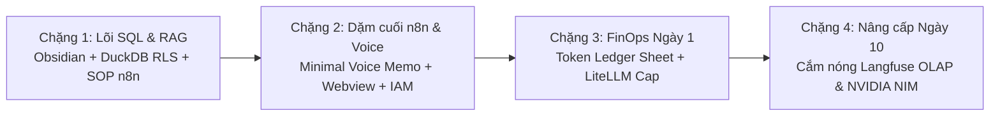

# Y7L Native Roadmap: Động Cơ Bootstrapping Lấy `n8n` Làm Trung Tâm

> **Tuyên ngôn Thực dụng (The Y7L Way):**  
> `03-y7l-native` vắt kiệt các công cụ nhẹ có sẵn (**n8n**, **Obsidian**, **DuckDB/Superset RLS**, **Postgres `pgvector` + BM25**, **Google Sheets**, **LiteLLM**) để đưa trọn bộ tính năng AI vào vận hành thực tế ngay từ **Ngày 1** với chi phí tối thiểu — trước khi nâng cấp sang cụm GPU (`01-nvidia-framework`) hoặc ClickHouse OLAP (`02-langfuse`) ở Ngày 10.

---

## ⚡ Các Chặng Phát Triển Kỹ Thuật (Engineering Milestones)

| Chặng Phát Triển | Nhiệm Vụ Cốt Lõi | Công Nghệ Thực Thi | Trạng Thái |
| :--- | :--- | :--- | :---: |
| **Chặng 1** | **Lõi Ngữ Nghĩa Data-Blind, Single-Hop DuckDB RLS & RAG SOP trong n8n** | Obsidian `.md` (`DATA_TRAP`) + `y7l-tools` DuckDB RLS + `WF-02` / `WF-03` (`pgvector` + BM25 + RRF) | 🟢 Đã hoàn thiện |
| **Chặng 2** | **Dặm Cuối Minimal Voice Memo, Webview 10h JWT & Cầu Dao IAM 2 Cấp** | `WF-01` (Whisper STT + `edge-tts` MP3) + `WF-04` (HTML Login + Redis) + `WF-05` (Google Sheet IAM) | 🟢 Đã hoàn thiện |
| **Chặng 3** | **FinOps Ngày 1 Không Cần Langfuse (Google Sheet Ledger) & Key Kill-Switch** | `WF-06` ghi token/model/USD lên Google Sheet `AI_Token_Ledger` + LiteLLM `:4000` `/key/block` | 🟢 Đã hoàn thiện |
| **Chặng 4** | **Chuyển Giao Titan Stack (Ngày 10 Khi Có ClickHouse / GPU)** | Cắm `LANGFUSE_PUBLIC_KEY`/`SECRET_KEY` vào LiteLLM (0 sửa n8n) + `auto-ontology` / `nemotron-voice-agent` | ⚪ Lộ trình nâng cấp |

---

## 🛠️ Chi Tiết Từng Chặng

### Chặng 1: Lõi Ngữ Nghĩa Data-Blind & RAG Trong n8n
* **Tầng Ngữ nghĩa SQL (`WF-02`):** Bộ file Obsidian `.md` nguyên khối (`vault/glossary`, `vault/tables`, `[[Wikilinks]]`, `DATA_TRAP`), tuyệt đối không chunking. Model sinh đúng 1 câu `SELECT` qua LiteLLM, `y7l-tools` kiểm duyệt read-only, tiêm RLS theo vùng `region` trên In-Process DuckDB (hoặc đẩy Superset SQL Lab) và xuất thẳng file `.csv`/`.xlsx`/`.md`.
* **RAG SOP Hybrid trong `n8n` (`WF-03`):** Tách chữ PDF/Markdown qua `y7l-tools`, tạo embedding qua LiteLLM, lưu và truy vấn `Dense Vector + BM25 + RRF` trong đúng 1 hàm PostgreSQL `y7l_hybrid_search_sop` để lấy Top-3 `< 4KB`.
* **Kiểm định tự động:** `evals/vault_linter.py`, `evals/run_evals.py` và bộ `pytest`.

### Chặng 2: Minimal Voice Memo, Webview 10h JWT & IAM Cầu Dao
* **Voice Memo 2 chiều tối thiểu (`WF-01`):** Nhận ghi âm thoại → gọi `/voice/stt` (Whisper proxy) → đi qua Intent Router (`KPI` / `SQL` / `SOP`) → gọi `/voice/tts` (`edge-tts` tiếng Việt miễn phí, không cần GPU) trả `.mp3` kèm link file báo cáo.
* **Webview Login 10h JWT (`WF-04`):** Form HTML riêng biệt ngoài khung chat, đổi user/pass lấy HS256 JWT lưu Redis TTL `36000s` và hủy mật khẩu ngay.
* **IAM 2 cấp Google Sheet (`WF-05`):** Đồng bộ `HR_Master_IAM` mỗi 1 phút; Cấp 1 (`Revoke Session`) xóa session Redis, Cấp 2 (`Inactive`) xóa session + khóa tài khoản IAM.

### Chặng 3: FinOps Ngày 1 Trên Google Sheet & Cầu Dao LiteLLM
* **Khi chưa bật Langfuse + ClickHouse (`WF-06`):** Mọi lượt gọi LLM trong `WF-01`, `WF-02`, `WF-03` đều bắn usage sang webhook `/webhook/y7l-token-log` của `WF-06`.
* **`WF-06` tự quy đổi USD** theo bảng giá từng model, ghi từng dòng (`timestamp`, `month`, `department`, `user_id`, `workflow`, `model`, `prompt_tokens`, `completion_tokens`, `total_tokens`, `estimated_cost_usd`, `status`) lên Google Sheet `AI_Token_Ledger`, cộng dồn chi tiêu tháng trên Redis và tự động gọi LiteLLM `/key/block` khi vượt trần ngân sách.

### Chặng 4: Bàn Giao Ngày 10 (0 Dòng Sửa n8n)
1. **FinOps & Evals:** Bật callback `langfuse` trên LiteLLM (`02-langfuse`) để toàn bộ trace/cost đổ thêm xuống ClickHouse OLAP mà không sửa 6 workflow n8n.
2. **SQL & Voice Enterprise:** Thay `y7l-tools` adapter sang `Superset SQL Lab` / `auto-ontology` (`:3003`) và nâng Voice Memo lên `nemotron-voice-agent` WebRTC (`:7860`) khi cần đàm thoại trực tiếp dưới 200ms.
