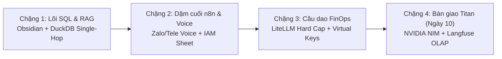

# Y7L Native Roadmap: Động Cơ Bootstrapping (The Pragmatic Path)

> **Tuyên ngôn Thực dụng (The Y7L Way):**  
> `03-y7l-native` đóng vai trò là **Động cơ mồi (Bootstrapping Engine)**: vắt kiệt tối đa các công cụ có sẵn (**n8n**, **Obsidian**, **Superset RLS**, **In-Memory DuckDB**, **LiteLLM**) để đưa toàn bộ 27 tính năng AI vào giải quyết bài toán thực tế của doanh nghiệp với chi phí gần như **$0 – $20/tháng**.  
> Nó tạo ra giá trị kinh doanh và sản phẩm sống ngay từ **Ngày 1**, làm đòn bẩy trước khi doanh nghiệp cần đầu tư cụm GPU bạc tỷ cho **Nhánh 1 (`01-nvidia-framework`)** hay cụm ClickHouse nặng nề của **Nhánh 2 (`02-langfuse`)**.

---

## ⚡ Các Chặng Phát Triển Kỹ Thuật (Engineering Milestones)

| Chặng Phát Triển | Nhiệm Vụ Cốt Lõi | Công Nghệ Thực Thi | Mục Tiêu Nghiệp Vụ | Trạng Thái |
| :--- | :--- | :--- | :--- | :---: |
| **Chặng 1** | **Lõi Ngữ Nghĩa Data-Blind & Text-to-SQL Cắt Vòng Lặp** | Obsidian Markdown + Superset RLS + DuckDB | Kế toán tra cứu số liệu tất định, không ảo giác SQL | 🟢 Đã hoàn thiện |
| **Chặng 2** | **Dặm Cuối Voice Memo (Zalo/Telegram) & IAM Cầu Dao** | n8n Webhook + Whisper/Edge-TTS + Google Sheet | Sếp & Sale hỏi đáp bằng tin nhắn thoại, HR quản lý quyền | 🟡 Đang hoàn thiện |
| **Chặng 3** | **Cầu Dao Cắt Tiền Tự Động & Quản Trị Virtual Key** | LiteLLM Proxy + Redis (`max_budget`, 1s Revocation) | Cắt tiền tự động khi lố ngân sách $5, khóa Key trong 1s | 🟢 Đã có cấu hình |
| **Chặng 4** | **Chuyển Giao Titan Stack (Khi Dữ Liệu > 500GB)** | FastMCP Bridge ➔ NVIDIA NIM & Langfuse OLAP | Nâng cấp khi quy mô doanh nghiệp phình to (Ngày 10) | ⚪ Lộ trình tương lai |

---

## 🛠️ Chi Tiết Triển Khai Từng Chặng

### Chặng 1: Lõi Ngữ Nghĩa Data-Blind & Text-to-SQL
*Thay vì mất công cấu hình `pgvector`, dựng pipeline embedding phức tạp và chỉnh `auto-ontology`:*
* **Tầng Ngữ nghĩa:** Tạo Obsidian Vault. Viết các file `.md` mô tả bảng OBT Gold (`300–800 tokens`), kết nối quan hệ bảng bằng `[[Wikilinks]]`.
* **Khóa logic tiếng Việt:** Kế toán trưởng mở file `.md` gõ trực tiếp các bẫy số liệu **`DATA_TRAP`** bằng tiếng Việt (`total_price = 0 thì tính quantity * unit_price`, `WHERE is_deleted = false`).
* **Chốt chặn Single-Hop Circuit Breaker:**
  * LLM đọc file `.md` từ Obsidian $\to$ sinh **đúng 1 câu SQL** rồi dừng.
  * n8n đẩy `SQL + JWT` sang **Superset SQL Lab** (tiêm Row-Level Security theo vùng miền) $\to$ quét thẳng trên **In-Memory DuckDB**.
  * Xuất kết quả thẳng ra File Excel/PDF/CSV trả về cho User, **không vòng ngược lại LLM**.
* 🎯 *Tiêu chí hoàn thành:* Kế toán hỏi số liệu doanh thu nhận được kết quả đúng 100%, không bị ảo giác SQL, RAM tiêu thụ `< 500MB`.

---

### Chặng 2: Dặm Cuối Voice Memo & IAM Cắt Truy Cập Trên n8n
*Thay vì dựng cụm hạ tầng WebRTC GPU và cài đặt Pipecat nặng nề:*
* **Luồng Voice Memo 2 chiều:**
  * Kéo thả **Webhook n8n**: Hút file ghi âm thoại (`.ogg` / `.mp3`) khi Sếp/Sale bấm giữ mic trên Zalo OA hoặc Telegram Bot.
  * Node 1: Gọi Whisper API (hoặc local Faster-Whisper CPU) bóc ra text câu hỏi.
  * Node 2: Đẩy text vào luồng Mimir Single-Hop lấy số liệu.
  * Node 3: Gọi Edge-TTS / Kokoro xuất file `.mp3` câu trả lời gửi ngược lại vào khung chat Zalo/Telegram.
* **IAM & Cầu dao 2 cấp trên Google Sheet:**
  * Nhân sự (HR) điền danh sách nhân viên vào Google Sheet $\to$ n8n định kỳ quét đồng bộ tài khoản sang Superset.
  * **Cấp 1 (`Revoke Session`):** HR tích ô trên Sheet $\to$ n8n gọi API xóa sạch JWT 10 tiếng của nhân viên mất điện thoại.
  * **Cấp 2 (`Inactive`):** HR đổi trạng thái sang Inactive $\to$ n8n xóa phiên Zalo và khóa tài khoản Superset ngay lập tức.
* 🎯 *Tiêu chí hoàn thành:* Sếp gửi tin nhắn thoại qua Zalo/Telegram, nhận lại file âm thanh tóm tắt số liệu kèm file báo cáo đính kèm.

---

### Chặng 3: Cầu Dao Cắt Tiền Tự Động & Quản Lý Virtual Key
*Chốt chặn tài chính, chống nguy cơ cháy tài khoản do nhân viên lạm dụng hoặc bot lặp vô hạn:*
* **Khởi động dịch vụ:** Khởi động container **`litellm-proxy` (`:4000`)** dùng chung Postgres (`schema=litellm`) và Redis của stack.
* **Cấp phát & Khóa ngân sách:** 
  * Cấp Virtual Key khóa cứng trần ngân sách: Sale = `$5.00 USD / tháng`, Kế toán = `$10.00 USD / tháng` (`max_budget`).
  * Khóa tốc độ gọi: `30 RPM`, `50,000 TPM` trên Redis.
  * Lệnh cắt API Key khẩn cấp trong 1 giây qua `/key/block` và `/key/delete`.
* 🎯 *Tiêu chí hoàn thành:* Khi gọi vượt hạn mức $5, hệ thống tự động trả HTTP 429 và ngắt điện ngay lập tức, không lọt 1 request nào lên nhà cung cấp.

---

## 🏁 Chặng 4: Bàn Giao Ngày 10 (Khi Dữ Liệu Lớn & Có Ngân Sách)

Khi công ty phát triển đến ngưỡng cần đầu tư cụm GPU chuyên dụng:
1. **Chuyển giao SQL:** File Obsidian `.md` được nạp tự động vào **`auto-ontology` (`:3000`)** trên Postgres `pgvector`.
2. **Chuyển giao Voice:** Từ Voice Memo Zalo nâng cấp lên đàm thoại WebRTC trực tiếp **`nemotron-voice-agent` (`:7860`)**.
3. **Chuyển giao FinOps:** Toàn bộ lịch sử cuộc gọi LiteLLM đổ về phân tích chuyên sâu trên **`ClickHouse OLAP`** và dashboard **`Langfuse` (`:3100`)**.
4. **Chuyển giao Tác tử:** Kịch bản n8n được bọc thành **FastMCP** để tác tử tự hành **`NemoClaw` (`:7681`)** trong lồng sắt OpenShell tiếp quản.

---

## 🎯 Giá Trị Thực Chiến

Toàn bộ kiến trúc Y7L Native chứng minh một chân lý kỹ thuật: **Không cần hạ tầng triệu đô vẫn giải quyết trọn vẹn bài toán Data & AI cho doanh nghiệp bằng tư duy phân tầng sắc bén và kỷ luật bảo mật Data-Blind!**
