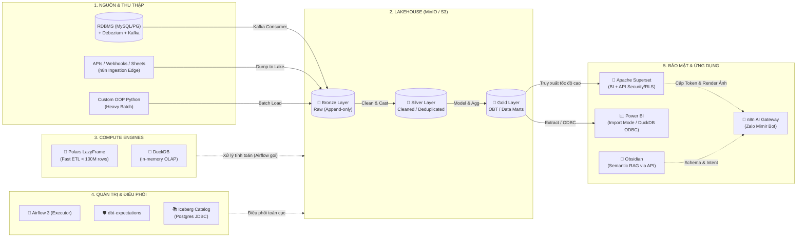

# 🗺️ Master Index: Yggdrasil (Y7L) Data Lake Knowledge Base (v2.0)

Chào mừng đến với **Yggdrasil Data Lake Knowledge Base** (gọi tắt là Y7L). Đây là bản đồ tri thức tổng quan (Map of Content - MOC) mô tả toàn bộ kiến trúc nền tảng dữ liệu hiện đại (Modern Data Lakehouse) được xây dựng theo 7 trụ cột cốt lõi. Phiên bản 2.0 tập trung vào **Single-Node Big Data**, **Zero Trust Security**, và **Data-Blind AI Architecture**.

👉 **ĐỌC ĐẦU TIÊN:** [[00_Data_Engineering_Manifesto|📜 Triết lý cốt lõi (Data Engineering Manifesto) - OOP + Config-Driven + Data Contract]]
👉 **BẢN CHỐT CÔNG NGHỆ:** [[10_Y7L_Technology_Stack_Blueprint|🏆 Final Technology Stack Blueprint (Yggdrasil v2.0)]]

---

## 🏛️ Kiến Trúc Hệ Thống Tổng Quan (System Architecture)

---

## 📚 7 Trụ Cột Tri Thức (Core Pillars)

### 1. [[01_Storage/Storage Architecture & Layout Conventions|01. Storage (Lớp Lưu trữ - MinIO/S3)]]
- Thiết kế nền tảng trên Object Storage (MinIO cho Local/On-premise, AWS S3 cho Cloud).

### 2. [[02_Table_Format/Apache Iceberg Fundamentals|02. Table Format (Định dạng bảng - Apache Iceberg)]]
- Chuyển đổi 100% sang **Apache Iceberg** (Khai tử Delta Lake).
- Sử dụng **Iceberg JDBC Catalog** để ghi ngược Metadata vào con Postgres một cách chặt chẽ.
- Khắc phục giới hạn của Data Lake: ACID Transactions, Time Travel, Schema Evolution.

### 3. [[03_Compute/Compute Architecture & Separation|03. Compute (Polars & DuckDB - Kỷ nguyên Single-Node)]]
- **Khai tử Apache Spark & Trino:** Tối ưu hóa hệ thống quy mô < 100 triệu dòng bằng **Polars LazyFrame** (Rust-based) để ETL siêu tốc, bỏ qua overhead của JVM và Server phân tán.
- **DuckDB**: Đóng vai trò Query Engine truy vấn trực tiếp Iceberg/Parquet cho Superset và Power BI.

### 4. [[04_Ingestion_and_Medallion/Medallion Architecture Overview|04. Data Ingestion & Medallion Architecture]]
- Mô hình **Medallion**:
  - [[04_Ingestion_and_Medallion/Bronze Layer - Raw & Append-Only|🥉 Bronze Layer]]: Lưu trữ Raw, Append-only.
  - [[04_Ingestion_and_Medallion/Silver Layer - Cleaning & Conformance|🥈 Silver Layer]]: Làm sạch, ép kiểu, Deduplication.
  - [[04_Ingestion_and_Medallion/Gold Layer - Business Aggregates & Marts|🥇 Gold Layer]]: Aggregations, Data Marts, One Big Table (OBT).
- Luồng Ingestion kết hợp **n8n** (Cửa ngõ hứng Webhook/API) và duy trì sự kiểm soát chặt chẽ bằng Code Python OOP cho các Batch nặng, không phụ thuộc hoàn toàn vào tool kéo thả.

### 5. [[05_Orchestration/Pipeline Orchestration & DAG Design|05. Orchestration (Airflow 3 Tâm điểm)]]
- **Airflow 3**: Đóng vai trò Central Orchestrator, chạy Parameterized DAGs, kích hoạt Engine Polars.
- **[[05_Orchestration/Standardizing Transformations (dbt & DLT)|Chuẩn hóa Transformation]]:** Vẫn giữ dbt để chống Spaghetti Pipelines, thiết lập "Luật giao thông" cho dependency.

### 6. [[06_Governance_Quality_Catalog/Data Quality Gates & Dimensions|06. Data Quality, Catalog & Governance]]
- **Apache Superset (Security Layer):** Phân quyền Row-Level Security (RLS) và JWT Token được xử lý tại cổng Superset. Đảm bảo Zero Trust.

### 7. [[07_Applications_BI_AI/BI Serving & Semantic Layer|07. BI / AI Applications (Sandwich Architecture)]]
- **Phục vụ BI:** Hội DA dùng Power BI (Import mode / DuckDB ODBC) hoặc giao diện Superset.
- **n8n AI Gateway (Mimir Bot)**: Đứng ở đầu ra Zalo. Sử dụng API của Superset (kèm JWT Token) để lấy số liệu và ảnh biểu đồ. Đảm bảo triệt để **Data-Blind AI**.

---

## 🛠️ Mẫu Tài Liệu & Vận Hành (Templates & Runbooks)
- [[99_Templates/Template - Table & Dataset Spec|📝 Template: Table / Dataset Specification]]
- [[99_Templates/Template - Pipeline Design Doc|📝 Template: Pipeline Design Doc]]
- [[99_Templates/Template - Incident & Runbook|📝 Template: Incident Post-Mortem & Runbook]]
